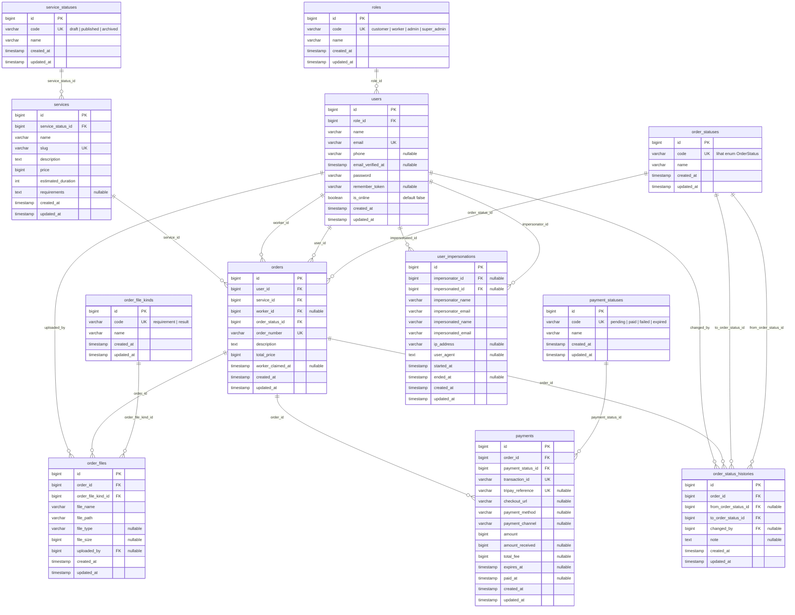

# ERD — Jovexa

Entity Relationship Diagram untuk aplikasi Jovexa (marketplace jasa digital dengan pembayaran Tripay).

**7 tabel domain:** `users`, `services`, `orders`, `order_files`, `order_status_histories`, `payments`, `user_impersonations`.
**5 tabel lookup:** `roles`, `service_statuses`, `order_statuses`, `payment_statuses`, `order_file_kinds`.
Tabel infrastruktur Laravel (`cache`, `jobs`, `sessions`, `migrations`, dll.) tidak digambarkan.

---

## Diagram



---

## Relasi (Foreign Key)

| No | Tabel anak | Kolom | → Tabel induk | Kardinalitas | On delete |
|----|------------|-------|--------------|--------------|-----------|
| 1 | `users` | `role_id` | `roles.id` | role 1 : N user | restrict |
| 2 | `services` | `service_status_id` | `service_statuses.id` | status 1 : N service | restrict |
| 3 | `orders` | `order_status_id` | `order_statuses.id` | status 1 : N order | restrict |
| 4 | `order_files` | `order_file_kind_id` | `order_file_kinds.id` | kind 1 : N file | restrict |
| 5 | `order_status_histories` | `from_order_status_id` | `order_statuses.id` | status 1 : N riwayat | restrict |
| 6 | `order_status_histories` | `to_order_status_id` | `order_statuses.id` | status 1 : N riwayat | restrict |
| 7 | `payments` | `payment_status_id` | `payment_statuses.id` | status 1 : N payment | restrict |
| 8 | `orders` | `user_id` | `users.id` | user 1 : N order | cascade |
| 9 | `orders` | `service_id` | `services.id` | service 1 : N order | restrict |
| 10 | `order_files` | `order_id` | `orders.id` | order 1 : N file | cascade |
| 11 | `order_files` | `uploaded_by` | `users.id` | user 1 : N file | null on delete |
| 12 | `order_status_histories` | `order_id` | `orders.id` | order 1 : N riwayat | cascade |
| 13 | `order_status_histories` | `changed_by` | `users.id` | user 1 : N riwayat | null on delete |
| 14 | `payments` | `order_id` | `orders.id` | order 1 : N payment | cascade |
| 15 | `orders` | `worker_id` | `users.id` | worker 1 : N order | null on delete |
| 16 | `user_impersonations` | `impersonator_id` | `users.id` | super admin 1 : N sesi | null on delete |
| 17 | `user_impersonations` | `impersonated_id` | `users.id` | user 1 : N sesi | null on delete |

> **Penting:** `payments` **hanya** punya FK langsung ke `orders.id` dan `payment_statuses.id`. Tidak ada FK langsung dari `users` ke `payments`.
> Hubungan user → payment bersifat **transitif**: `users (1) → orders (N) → payments (N)`.

---

## Alur relasi

```text
roles ──< users ──< orders ──< order_files
                  │          │  └──< order_status_histories
                  │          └──< payments
                  ├──< order_files           (uploaded_by)
                  ├──< order_status_histories (changed_by)
                  ├──< orders                (worker_id)
                  ├──< user_impersonations   (impersonator_id)
                  └──< user_impersonations   (impersonated_id)

service_statuses ──< services ──< orders
order_statuses   ──< orders
order_statuses   ──< order_status_histories (from/to)
order_file_kinds ──< order_files
payment_statuses ──< payments
```

---

## Unique Key

| Tabel | Kolom | Keterangan |
|-------|-------|------------|
| `roles` | `code` | kode role unik |
| `service_statuses` | `code` | kode status jasa unik |
| `order_statuses` | `code` | kode status order unik |
| `payment_statuses` | `code` | kode status pembayaran unik |
| `order_file_kinds` | `code` | kode jenis file unik |
| `users` | `email` | email login unik |
| `services` | `slug` | alamat URL jasa |
| `orders` | `order_number` | format `JVX-YYYYMMDD-XXXX` |
| `payments` | `transaction_id` | id internal transaksi |
| `payments` | `tripay_reference` | referensi dari gateway Tripay |

---

## Catatan desain

- **Tabel lookup memakai surrogate key.** Kolom `code` menjadi sumber nilai enum (`UserRole`, `ServiceStatus`, `OrderStatus`, `PaymentStatus`) dan `order_files.kind`.
- **Model tetap mengekspos enum.** Accessor `role`, `status`, `kind`, `from_status`, dan `to_status` memetakan lookup row kembali ke enum agar kode lama tetap berjalan.
- **`orders` → `payments` adalah 1:N**, bukan 1:1. Satu order boleh punya beberapa percobaan transaksi (mis. gagal lalu bayar ulang). Yang aktif ditampilkan lewat `Order::latestPayment()` (`latestOfMany()`).
- **`order_status_histories`** adalah audit trail tiap perubahan status. `changed_by` nullable karena perubahan bisa datang dari webhook gateway / scheduler, bukan user.
- **`order_files.order_file_kind_id`** membedakan `requirement` (unggahan customer) dan `result` (hasil kerja Admin/Worker) dalam satu tabel.
- **`orders.worker_id`** menyimpan Worker yang mengklaim order. `worker_claimed_at` mencatat waktu klaim; keduanya nullable.
- **`user_impersonations`** menyimpan audit start/stop impersonation beserta snapshot nama/email pelaku dan target, sehingga riwayat tetap terbaca setelah akun berubah atau dihapus.
- **`uploaded_by` dan `orders.worker_id` memakai `nullOnDelete`**, sehingga file/order tetap tersimpan saat akun Worker dihapus. Penghapusan Worker dengan order aktif tetap dicegah di level aplikasi.
- **FK lookup memakai `restrictOnDelete`**, sehingga baris lookup yang masih dipakai tidak bisa dihapus.
- Semua `created_at` / `updated_at` mengikuti konvensi timestamps Laravel.
