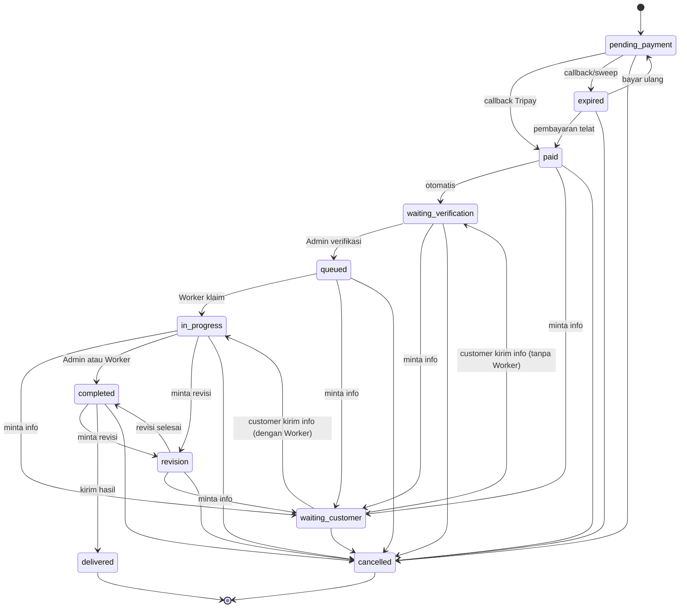

# PRD — Jovexa

> **Status dokumen:** baseline kondisi project saat ini (as-is).
> **Tanggal baseline:** 26 Oktober 2026.
> **Cara pakai:** Bagian **A** menjelaskan apa yang sudah berjalan hari ini. Bagian **B** disediakan untuk kamu isi/ubah sebagai rencana pengembangan berikutnya. Tandai setiap requirement dengan salah satu status: `Sudah ada`, `Sebagian`, `Belum`, atau `Di luar lingkup`.
>
> Dokumen ini tidak memuat kredensial. Nilai rahasia hanya boleh berada di `.env` dan tidak boleh ditulis di PRD, issue, atau repository.

---

## 1. Ringkasan Produk

**Jovexa** adalah platform web penyedia jasa digital. Customer dapat melihat katalog jasa, membuat pesanan, mengunggah kebutuhan, membayar melalui payment gateway **Tripay**, lalu memantau progres sampai file hasil dapat diunduh. Admin memverifikasi pembayaran dan melepas pesanan ke antrean, Worker mengambil pesanan dari antrean dan mengerjakannya, lalu Admin atau Worker mengirim hasil ke customer. Super Admin mengelola akun, role, dan impersonation.

Untuk versi saat ini, role dipisahkan menjadi **Super Admin**, **Admin**, **Worker**, dan **Customer**. Admin hanya menangani operasional jasa dan pesanan; pengelolaan akun dan impersonation hanya dapat dilakukan Super Admin.

**Nilai utama produk:**

1. Proses pemesanan jasa yang jelas dan dapat dilacak.
2. Status pesanan yang transparan bagi customer.
3. Pembayaran yang dikonfirmasi di sisi server melalui callback Tripay, bukan dari klik browser.
4. Antrean kerja terstruktur: Admin memverifikasi, Worker mengklaim pesanan, lalu hasil dikirim ke customer.

**Stack aktual:**

| Komponen | Kondisi saat ini |
|---|---|
| Backend | Laravel 13.33, PHP 8.3 |
| Database lokal | MySQL |
| Frontend | Blade, Bootstrap 5, Vite 8, JavaScript vanilla |
| Tema | Public/customer/auth/error memakai tema `playful`; admin memakai Spark |
| Pembayaran | Tripay (konfigurasi aktif: sandbox) |
| Testing | PHPUnit 12 |
| Bahasa aplikasi | Indonesia (`APP_LOCALE=id`) |
| Zona waktu aplikasi | `UTC` |

---

## 2. Latar Belakang & Masalah

Pemesanan jasa digital lewat chat manual memiliki masalah umum:

- Harga dan cakupan pekerjaan tidak selalu jelas.
- Status pengerjaan sulit dipantau customer.
- Bukti pembayaran dan riwayat perubahan status mudah hilang.
- Admin dan Worker kesulitan membedakan pesanan yang sudah dibayar, menunggu antrean, sedang dikerjakan, menunggu customer, atau perlu revisi.
- Konfirmasi pembayaran dari halaman redirect browser tidak cukup aman.

Jovexa menjawab masalah tersebut dengan katalog jasa terstruktur, order dengan nomor unik, pembayaran Tripay, status workflow yang terkontrol, riwayat status, dan penyimpanan file privat.

---

## 3. Tujuan, Non-Tujuan, dan Metrik

### 3.1 Tujuan MVP

- Menjalankan alur utama secara stabil: **Pilih Jasa → Order → Upload → Bayar → Verifikasi → Kerjakan → Upload Hasil → Kirim ke Customer**.
- Memastikan pesanan tidak masuk pengerjaan sebelum pembayaran terkonfirmasi.
- Memastikan status pembayaran hanya berubah berdasarkan callback gateway atau rekonsiliasi server.
- Memberi customer visibilitas progres dan akses unduh hasil.
- Memberi Admin alat untuk mengelola order dan jasa, Worker alat untuk mengerjakan order, serta Super Admin alat untuk mengelola pengguna dan impersonation.

### 3.2 Non-Tujuan (saat ini)

- Bukan marketplace multi-vendor atau sistem bidding/lelang.
- Bukan aplikasi mobile native atau aplikasi desktop Electron. File `elektron.md` hanya catatan belajar, bukan bagian implementasi.
- Bukan sistem penggajian, absensi, atau manajemen tim internal.
- Tidak menangani refund, sengketa, atau pembayaran parsial secara otomatis.
- Tidak menyediakan API publik atau integrasi pihak ketiga selain Tripay.
- Tidak menyediakan chat internal antara customer dan Admin/Worker.
- Tidak menyediakan notifikasi otomatis saat kuota atau antrean berubah.
- Tidak menyediakan penugasan worker manual; pesanan diambil Worker dari antrean.

### 3.3 Metrik Keberhasilan (usulan, belum diinstrumentasi)

| Metrik | Definisi | Status |
|---|---|---|
| Order-to-payment conversion | Persentase order yang mencapai `paid` | Belum ada analytics |
| Payment confirmation success | Persentase transaksi yang berhasil dikonfirmasi callback/rekonsiliasi | Belum ada dashboard |
| Verification latency | Waktu dari `waiting_verification` ke `queued` | Belum diukur |
| Claim latency | Waktu dari `queued` sampai diklaim Worker | Belum diukur |
| Delivery success | Persentase order `completed` yang berhasil menjadi `delivered` | Belum diukur |
| Manual correction rate | Jumlah order yang statusnya harus dikoreksi manual | Belum diukur |
| Callback failure rate | Jumlah callback gagal signature/merchant/amount | Hanya tercatat di log |

---

## 4. Persona & Role

### 4.1 Visitor

- Melihat landing page, katalog jasa, dan detail jasa.
- Diarahkan login/register saat ingin memesan.

### 4.2 Customer

- Registrasi dan login.
- Melihat katalog dan detail jasa.
- Membuat pesanan untuk jasa yang berstatus published.
- Mengisi deskripsi kebutuhan dan mengunggah file pendukung.
- Membayar melalui Tripay.
- Memantau status dan riwayat pesanan.
- Mengunggah file tambahan saat diminta Admin atau Worker.
- Mengunduh file hasil setelah pesanan selesai/dikirim.
- Membatalkan pesanan selama status belum final.

### 4.3 Admin

- Melihat dashboard dan seluruh pesanan.
- Mencari dan memfilter pesanan.
- Memverifikasi pembayaran dan melepas pesanan ke antrean Worker.
- Meminta informasi tambahan kepada customer.
- Menangani revisi, menyelesaikan pesanan, dan mengirim hasil.
- Mengelola jasa (tambah, ubah, arsip, tayangkan).
- Tidak dapat mengelola akun, role, atau impersonation.

### 4.4 Super Admin

- Memiliki akses operasional Admin.
- Melihat, mencari, dan memfilter pengguna.
- Mengubah role Customer/Worker/Admin.
- Menghapus akun non-Super Admin.
- Melakukan impersonation ke akun Admin, Worker, atau Customer.
- Melihat audit trail impersonation.

### 4.5 Worker

- Mengaktifkan status online/offline.
- Melihat antrean pesanan `queued`.
- Mengklaim maksimal 5 pesanan aktif.
- Mengerjakan pesanan yang di-assign kepada dirinya.
- Meminta informasi tambahan, menandai selesai/revisi, mengunggah hasil, dan mengirim hasil.
- Tidak dapat mengakses pesanan worker lain atau halaman pengguna.

### 4.6 Payment Gateway (Tripay)

- Membuat transaksi pembayaran.
- Menyediakan daftar channel pembayaran aktif.
- Mengirim callback status pembayaran.
- Menyediakan endpoint detail transaksi untuk rekonsiliasi.

---

## 5. Scope & Status Ringkas

| Area | Status | Catatan |
|---|---|---|
| Landing page publik | Sudah ada | Termasuk featured services, FAQ, kontak |
| Katalog & detail jasa | Sudah ada | Hanya jasa `published`, pencarian sederhana |
| Registrasi, login, logout, reset password | Sudah ada | Verifikasi email belum ditegakkan |
| Dashboard customer | Sudah ada | Statistik dan 5 pesanan terbaru |
| Daftar & detail pesanan customer | Sudah ada | Filter status di sisi browser |
| Pembuatan order & upload requirement | Sudah ada | Maksimal 5 file per upload |
| Pembayaran Tripay | Sudah ada | Sandbox, channel cache, fallback |
| Callback pembayaran | Sudah ada | HMAC, merchant check, throttle |
| Expiry & rekonsiliasi pembayaran | Sudah ada | Dijalankan scheduler |
| Dashboard Admin | Sudah ada | Statistik pipeline termasuk antrean Worker dan pendapatan |
| Dashboard Worker | Sudah ada | Status online, kuota, pesanan aktif, antrean |
| Verifikasi, minta info, revisi, delivery | Sudah ada | Dibatasi state machine dan kepemilikan Worker |
| Antrean & klaim Worker | Sudah ada | Klaim atomik, kuota 5, hanya saat online |
| Kelola jasa | Sudah ada | Create/update/archive/publish; tanpa delete |
| Kelola pengguna | Sudah ada | Khusus Super Admin; promosi/demote Customer, Worker, Admin |
| Impersonation + audit | Sudah ada | Super Admin ke akun non-Super Admin |
| Riwayat status | Sudah ada | Audit trail per perubahan |
| Notifikasi email/WhatsApp | Belum | Status hanya terlihat di halaman |
| Invoice/receipt | Belum | Belum ada dokumen pembayaran |
| Refund/dispute | Belum | Di luar scope saat ini |
| Kategori/tag/gambar jasa | Belum | Hanya field teks |
| Rating/review/kupon | Belum | Belum ada |
| Laporan/export | Belum | Belum ada |
| API publik/mobile app | Belum | Web only |
| Queue job asynchronous | Belum | Koneksi database tersedia, belum dipakai |

---

## 6. Alur Pengguna

### 6.1 Alur Customer

1. Customer membuka landing page.
2. Customer membuka katalog jasa.
3. Customer memilih jasa dan membuka detail.
4. Customer menekan **Pesan Jasa**.
5. Jika belum login, customer diarahkan ke login/register.
6. Customer mengisi deskripsi kebutuhan (20–5.000 karakter).
7. Customer dapat mengunggah maksimal 5 file pendukung (maksimal 10 MB per file).
8. Order dibuat dengan status `pending_payment` dan nomor unik.
9. Customer membuka halaman pembayaran.
10. Customer memilih channel Tripay yang tersedia.
11. Sistem membuat transaksi dan mengarahkan customer ke checkout Tripay.
12. Tripay mengirim callback.
13. Jika pembayaran berhasil, order menjadi `paid` lalu `waiting_verification`.
14. Admin memverifikasi. Bila informasi kurang, order menjadi `waiting_customer` dan customer mengunggah file tambahan.
15. Jika valid, Admin melepas order ke antrean (`queued`).
16. Worker yang online mengklaim order; order menjadi `in_progress` dan ter-assign ke Worker tersebut.
17. Setelah selesai, order menjadi `completed`, file hasil diunggah, lalu dikirim menjadi `delivered`.
18. Customer mengunduh hasil dari halaman detail pesanan.

### 6.2 Alur Admin

1. Admin melihat dashboard dan seluruh pesanan.
2. Admin membuka detail pesanan dan memeriksa data customer, jasa, deskripsi, file, serta pembayaran.
3. Jika informasi kurang, Admin mengirim permintaan informasi (catatan minimal 10 karakter).
4. Jika valid, Admin memindahkan order dari `waiting_verification` ke `queued`.
5. Admin tidak dapat memindahkan `queued` langsung ke `in_progress`; langkah itu hanya boleh terjadi lewat klaim Worker.
6. Admin dapat meminta revisi, menandai selesai, mengunggah hasil, dan mengirim hasil.
7. Jika customer menjawab saat Worker sudah ditugaskan, order kembali ke `in_progress`.

### 6.3 Alur Worker

1. Worker membuka dashboard dan mengaktifkan status online.
2. Worker melihat antrean pesanan `queued` yang belum memiliki Worker.
3. Worker mengklaim pesanan selama kuota aktif belum mencapai 5.
4. Sistem mengunci baris order dan Worker, memastikan kuota, lalu mengubah status menjadi `in_progress`.
5. Worker menyelesaikan pekerjaan dan mengubah status menjadi `completed`.
6. Worker mengunggah file hasil (maksimal 20 MB).
7. Worker mengirim hasil; sistem menolak jika belum ada file hasil.
8. Worker hanya dapat mengakses pesanan yang ter-assign kepadanya.

### 6.4 Alur Super Admin

1. Super Admin membuka halaman kelola pengguna.
2. Super Admin mencari pengguna dan memfilter berdasarkan role.
3. Super Admin dapat mengubah role Customer/Worker/Admin atau menghapus akun non-Super Admin.
4. Super Admin tidak dapat mengubah role atau menghapus akun Super Admin, termasuk akun sendiri.
5. Worker dengan pesanan aktif tidak dapat diturunkan role atau dihapus.
6. Super Admin dapat memulai impersonation ke akun non-Super Admin.
7. Setiap impersonation dicatat di `user_impersonations` dan dapat diakhiri lewat tombol kembali.

### 6.5 Diagram State Order



Catatan:

- `paid` dan `expired` hanya boleh dicapai lewat gateway (`confirmedByGateway: true`).
- `queued` hanya boleh dicapai Admin dari `waiting_verification`.
- `in_progress` dari `queued` hanya boleh dicapai lewat klaim Worker.
- `delivered` hanya boleh dicapai lewat aksi kirim dan wajib sudah memiliki file hasil.
- Order `delivered` dan `cancelled` adalah status final.
- `expired` masih dapat dibayar; pembayaran telat harus tetap diterima.

---

## 7. Functional Requirements

Legenda status: `Sudah ada` = diimplementasikan; `Sebagian` = ada tetapi terbatas; `Belum` = belum ada; `Di luar lingkup` = sengaja tidak dikerjakan.

### 7.1 Autentikasi & Akun

| ID | Requirement | Acceptance Criteria | Status |
|---|---|---|---|
| AUTH-01 | Registrasi customer | Nama, email unik, nomor WhatsApp opsional, password minimal 8 karakter dan konfirmasi; akun otomatis login dan role `customer` | Sudah ada |
| AUTH-02 | Login | Email/password; opsi remember me; redirect ke dashboard sesuai role; 5 percobaan gagal per email+IP | Sudah ada |
| AUTH-03 | Logout | Session diinvalidasi dan token CSRF diregenerasi | Sudah ada |
| AUTH-04 | Lupa/reset password | Link reset dikirim lewat mail; password baru minimal 8 karakter dan konfirmasi | Sudah ada |
| AUTH-05 | Otorisasi role | Route customer untuk `customer`; route admin untuk `admin`/`super_admin`; route worker untuk `worker`; halaman pengguna dan impersonation hanya `super_admin`; pelanggaran menghasilkan 403 | Sudah ada |
| AUTH-06 | Verifikasi email | Email harus diverifikasi sebelum memesan | Belum |
| AUTH-07 | Profil & ubah password | Customer/Admin dapat mengubah nama, telepon, email, dan password dari halaman profil | Belum |
| AUTH-08 | 2FA | Autentikasi dua faktor | Di luar lingkup |

Catatan: Self-registration selalu menghasilkan role `customer`. Perubahan role dilakukan Super Admin lewat halaman kelola pengguna. Super Admin awal dibuat dari `SUPER_ADMIN_*` melalui seeder, bukan lewat registrasi publik.

### 7.2 Halaman Publik

| ID | Requirement | Acceptance Criteria | Status |
|---|---|---|---|
| PUB-01 | Landing page | Menampilkan hero, statistik jumlah jasa, fitur, 3 jasa termurah, cara pesan, CTA, FAQ, dan kontak | Sudah ada |
| PUB-02 | Katalog jasa | Hanya jasa `published`; pencarian `q` pada nama/slug/deskripsi; urut harga termurah; 9 per halaman | Sudah ada |
| PUB-03 | Detail jasa | Hanya jasa `published`; menampilkan harga, estimasi hari, deskripsi, persyaratan, 3 jasa lain, dan CTA pesan/login | Sudah ada |
| PUB-04 | Kontak publik | WhatsApp dan email dari config `jovexa.contact`; disembunyikan bila kosong | Sudah ada |
| PUB-05 | Halaman error | Halaman 403 dan 404 khusus tersedia | Sudah ada |
| PUB-06 | Kategori/tag jasa | Pengelompokan jasa | Belum |
| PUB-07 | Gambar/thumbnail jasa | Upload gambar untuk katalog dan detail | Belum |
| PUB-08 | Rating/review | Ulasan customer setelah order selesai | Belum |

### 7.3 Pemesanan (Customer)

| ID | Requirement | Acceptance Criteria | Status |
|---|---|---|---|
| ORD-01 | Membuat order | Hanya untuk jasa `published`; total harga disalin dari harga jasa saat order dibuat; nomor unik `JVX-YYYYMMDD-XXXX` | Sudah ada |
| ORD-02 | Validasi kebutuhan | Deskripsi wajib 20–5.000 karakter | Sudah ada |
| ORD-03 | Upload requirement | Maksimal 5 file per request; maksimal 10 MB per file; ekstensi diizinkan; disimpan di disk privat | Sudah ada |
| ORD-04 | Status awal order | Order baru `pending_payment`; riwayat status awal dicatat | Sudah ada |
| ORD-05 | Daftar pesanan customer | Hanya order milik sendiri; 10 per halaman; filter tab Semua/Berjalan/Selesai/Perlu tindakan di browser | Sudah ada |
| ORD-06 | Detail pesanan | Menampilkan stepper progres, ringkasan, file, pembayaran terakhir, dan riwayat status | Sudah ada |
| ORD-07 | File tambahan | Hanya saat status `waiting_customer`; maksimal 5 file; setelah upload order kembali ke `waiting_verification` bila belum ada Worker, atau `in_progress` bila sudah ter-assign | Sudah ada |
| ORD-08 | Pembatalan customer | Customer dapat membatalkan order selama status belum final; order menjadi `cancelled` | Sudah ada |
| ORD-09 | Unduh requirement | Customer dapat mengunduh file requirement miliknya sepanjang order masih ada | Sudah ada |
| ORD-10 | Unduh hasil | File hasil hanya bisa diunduh saat status `completed` atau `delivered` | Sudah ada |
| ORD-11 | Larangan ubah status | Customer tidak dapat mengubah status order secara manual selain aksi tambah file dan pembatalan | Sudah ada |
| ORD-12 | Edit/hapus order | Customer tidak dapat mengedit atau menghapus order; hanya membatalkan | Sudah ada |
| ORD-13 | Order oleh admin/guest checkout | Admin membuat order atas nama customer atau checkout tanpa akun | Belum |
| ORD-14 | Simpan draft order | Customer dapat menyimpan order sebelum membayar sebagai draft terpisah | Di luar lingkup |

### 7.4 Pembayaran Tripay

| ID | Requirement | Acceptance Criteria | Status |
|---|---|---|---|
| PAY-01 | Halaman pembayaran | Hanya untuk order milik customer dan status `pending_payment`/`expired` | Sudah ada |
| PAY-02 | Daftar channel | Mengambil channel aktif dari Tripay; cache; fallback config saat gateway tidak terjangkau; peringatan bila daftar hanya perkiraan | Sudah ada |
| PAY-03 | Membuat transaksi | Channel divalidasi; transaksi lama yang masih terbuka dipakai ulang; lock non-blocking mencegah transaksi ganda; panggilan gateway dilakukan sebelum baris payment disimpan | Sudah ada |
| PAY-04 | Checkout | Menyimpan reference, checkout URL, channel, dan waktu kedaluwarsa; customer diarahkan ke checkout Tripay | Sudah ada |
| PAY-05 | Callback | Endpoint `POST /notifikasi/tripay`; CSRF-exempt; throttle 60/menit/IP; signature HMAC-SHA256 dari raw body; event `payment_status`; merchant code dicek | Sudah ada |
| PAY-06 | Idempotensi | Callback `paid` berulang tidak menimpa amount/fee/paid_at; callback pending diabaikan | Sudah ada |
| PAY-07 | Validasi nominal | Nominal callback harus sama dengan tagihan order | Sudah ada |
| PAY-08 | Pemetaan status gateway | `PAID/SETTLED/SUCCESS` → `paid`; `EXPIRED` → `expired`; `FAILED/DENIED/CANCELLED` → `failed`; lainnya → `pending` | Sudah ada |
| PAY-09 | Dampak ke order | `paid` memindahkan order payable ke `paid` lalu `waiting_verification`; `expired` hanya memindahkan order `pending_payment`; `failed` tidak memindahkan order sehingga bisa dibayar ulang | Sudah ada |
| PAY-10 | Expiry otomatis | Command `tripay:expire-stale-payments` dijalankan setiap 5 menit; payment pending yang punya `checkout_url` dan lewat `expires_at` di-expire | Sudah ada |
| PAY-11 | Rekonsiliasi | Command `tripay:reconcile-payments` berjalan tiap jam; memeriksa pending > 60 menit dan expired dalam 7 hari terakhir; memakai `/transaction/detail` | Sudah ada |
| PAY-12 | Sinkronisasi channel | Command manual `tripay:sync-channels` untuk menyegarkan cache channel | Sudah ada |
| PAY-13 | Refund | Refund penuh/sebagian dari dashboard | Belum |
| PAY-14 | Invoice/receipt | Dokumen pembayaran yang bisa diunduh customer | Belum |
| PAY-15 | Pembayaran parsial/DP | Pembayaran bertahap | Di luar lingkup |
| PAY-16 | Multi-currency | Selain IDR | Di luar lingkup |

Catatan operasional: scheduler harus berjalan (`php artisan schedule:work` atau cron `* * * * * php artisan schedule:run`). Tanpa scheduler, order yang callback-nya hilang tidak akan dipulihkan otomatis.

### 7.5 Dashboard Customer

| ID | Requirement | Acceptance Criteria | Status |
|---|---|---|---|
| CUS-01 | Statistik dashboard | Menampilkan jumlah pesanan aktif, menunggu pembayaran, dan pesanan `delivered` | Sudah ada |
| CUS-02 | Pesanan terbaru | Menampilkan 5 pesanan terbaru customer | Sudah ada |
| CUS-03 | Aksi cepat | Tombol membuat pesanan baru dan membuka detail pesanan | Sudah ada |
| CUS-04 | Notifikasi status | Notifikasi email/WhatsApp saat status berubah | Belum |
| CUS-05 | Tracking estimasi | Estimasi selesai berbasis SLA/tanggal | Belum |

### 7.6 Dashboard & Workflow Admin, Worker, dan Super Admin

| ID | Requirement | Acceptance Criteria | Status |
|---|---|---|---|
| ADM-01 | Dashboard admin | Menampilkan jumlah `waiting_verification`, `queued`, `in_progress`, `waiting_customer`, `revision`; pendapatan `completed`+`delivered`; jumlah jasa published; 8 order terbaru yang perlu perhatian | Sudah ada |
| ADM-02 | Daftar pesanan | Semua order; filter status; pencarian nomor order/nama/email customer; 10 per halaman | Sudah ada |
| ADM-03 | Daftar revisi | Hanya order `revision`; pencarian; 10 per halaman | Sudah ada |
| ADM-04 | Riwayat pesanan | Hanya order `delivered` dan `cancelled`; pencarian; 10 per halaman | Sudah ada |
| ADM-05 | Detail pesanan | Menampilkan kebutuhan customer, file, riwayat status, data customer, dan total | Sudah ada |
| ADM-06 | Transisi status | Perubahan status mengikuti aturan `OrderStatus::canTransitionTo()`; `paid`/`expired`/`delivered` tidak bisa diset manual; Admin tidak dapat melewati antrean Worker (`queued → in_progress`); catatan opsional | Sudah ada |
| ADM-07 | Minta informasi | Catatan wajib 10–1.000 karakter; order menjadi `waiting_customer` | Sudah ada |
| ADM-08 | Konfirmasi info diterima | Order `waiting_customer` tanpa Worker dikembalikan ke `waiting_verification`; bila sudah ter-assign, customer yang menjawab mengembalikannya ke `in_progress` | Sudah ada |
| ADM-09 | Minta revisi | Dari `in_progress` atau `completed` ke `revision` | Sudah ada |
| ADM-10 | Revisi selesai | Dari `revision` ke `completed` | Sudah ada |
| ADM-11 | Upload hasil | Hanya saat `completed`; satu file per submit; file maksimal 20 MB; upload berikutnya menambah file; disimpan privat | Sudah ada |
| ADM-12 | Kirim hasil | Hanya saat `completed` dan minimal ada satu file hasil; order menjadi `delivered` | Sudah ada |
| ADM-13 | Pembatalan admin | Admin dapat membatalkan order selama belum final | Sudah ada |
| ADM-14 | Unduh file | Admin dapat mengunduh semua file order | Sudah ada |
| ADM-15 | Pelepasan ke antrean | Admin mengubah `waiting_verification` menjadi `queued` | Sudah ada |
| ADM-16 | Catatan internal | Catatan yang tidak terlihat customer | Belum |
| ADM-17 | SLA/deadline | Deadline pengerjaan dan peringatan keterlambatan | Belum |
| ADM-18 | Laporan/export | Export order/pendapatan ke CSV/Excel/PDF | Belum |
| ADM-19 | Bulk action | Perubahan status massal | Belum |
| WKR-01 | Antrean Worker | Worker hanya melihat order `queued` yang belum memiliki Worker | Sudah ada |
| WKR-02 | Status online | Worker dapat mengubah status online/offline; klaim hanya saat online | Sudah ada |
| WKR-03 | Klaim atomik | Order dan Worker dikunci dalam transaksi; order yang sama tidak dapat diklaim dua kali | Sudah ada |
| WKR-04 | Kuota aktif | Maksimal 5 order aktif per Worker; order `completed` yang belum dikirim tetap dihitung | Sudah ada |
| WKR-05 | Isolasi akses | Worker hanya dapat melihat dan mengubah order miliknya | Sudah ada |
| WKR-06 | Aksi Worker | Worker dapat minta info, menandai `completed`/`revision`, upload hasil, dan mengirim hasil | Sudah ada |

Catatan: UI detail admin terutama menampilkan langkah status berikutnya. Validasi request tetap mengizinkan transisi lain yang sah menurut state machine, misalnya `waiting_verification` → `waiting_customer` atau `in_progress` → `revision`.

### 7.7 Kelola Jasa

| ID | Requirement | Acceptance Criteria | Status |
|---|---|---|---|
| SVC-01 | Tambah jasa | Nama, slug otomatis/manual, deskripsi minimal 20 karakter, harga minimal Rp1.000, estimasi 1–365 hari, persyaratan opsional, status | Sudah ada |
| SVC-02 | Ubah jasa | Semua field dapat diubah; slug unik; perubahan harga tidak mengubah total order lama | Sudah ada |
| SVC-03 | Arsip/tayang | Jasa dapat diarsipkan dan ditayangkan kembali | Sudah ada |
| SVC-04 | Visibilitas publik | Hanya `published` yang tampil di katalog dan dapat dipesan | Sudah ada |
| SVC-05 | Hapus jasa | Jasa dihapus permanen | Belum; sengaja archive-only |
| SVC-06 | Kategori/tag | Klasifikasi jasa | Belum |
| SVC-07 | Gambar jasa | Thumbnail dan galeri | Belum |
| SVC-08 | Kebijakan revisi per jasa | Batas jumlah revisi dan cakupannya | Belum |
| SVC-09 | Audit perubahan jasa | Riwayat siapa mengubah jasa dan apa yang berubah | Belum |

### 7.8 Kelola Pengguna

| ID | Requirement | Acceptance Criteria | Status |
|---|---|---|---|
| USR-01 | Daftar pengguna | Khusus Super Admin; pencarian nama/email; filter role; jumlah order dan order Worker; 10 per halaman | Sudah ada |
| USR-02 | Ubah role | Super Admin dapat mengubah Customer/Worker/Admin; role `super_admin` tidak dapat dipilih dari halaman | Sudah ada |
| USR-03 | Larangan ubah role sendiri | Super Admin tidak bisa mengubah role akunnya sendiri | Sudah ada |
| USR-04 | Perlindungan Super Admin | Super Admin tidak dapat diubah role atau dihapus dari halaman pengguna | Sudah ada |
| USR-05 | Hapus pengguna | Super Admin dapat menghapus akun non-Super Admin; Worker dengan order aktif tidak dapat dihapus | Sudah ada |
| USR-06 | Profil pengguna | Customer/Admin/Worker dapat mengubah profil sendiri | Belum |
| USR-07 | Soft delete/anonymization | Menghapus akun tanpa menghapus order terkait | Belum |
| USR-08 | Impersonation | Super Admin dapat masuk sebagai Customer/Worker/Admin; tidak untuk Super Admin; tidak dapat nested; dapat kembali tanpa logout | Sudah ada |
| USR-09 | Audit impersonation | Setiap sesi mencatat pelaku, target, snapshot nama/email, IP, user agent, mulai, dan selesai | Sudah ada |

Catatan penting: penghapusan customer saat ini memicu cascade pada `orders`, sehingga order, file, payment, dan riwayat status milik customer tersebut ikut terhapus. `uploaded_by` pada `order_files` diubah menjadi `null` saat user dihapus. `worker_id` pada order juga menjadi `null` saat Worker dihapus, tetapi penghapusan Worker dengan order aktif dicegah.

### 7.9 Riwayat Status & Audit

| ID | Requirement | Acceptance Criteria | Status |
|---|---|---|---|
| AUD-01 | Pencatatan status | Setiap perubahan status menulis baris `order_status_histories` berisi status asal, status tujuan, aktor, catatan, dan waktu | Sudah ada |
| AUD-02 | Status awal | Order baru mencatat status awal `pending_payment` dengan catatan "Pesanan dibuat." | Sudah ada |
| AUD-03 | Aktor sistem | Perubahan dari callback/scheduler memiliki `changed_by = null` | Sudah ada |
| AUD-04 | Audit impersonation | Setiap start/stop impersonation dicatat di `user_impersonations` | Sudah ada |
| AUD-05 | Audit login/admin | Log login, perubahan jasa, dan perubahan user | Belum |
| AUD-06 | Retensi audit | Kebijakan retensi dan arsip | Belum |

### 7.10 File & Penyimpanan

| ID | Requirement | Acceptance Criteria | Status |
|---|---|---|---|
| FIL-01 | Penyimpanan privat | File disimpan di disk `local`, tidak dapat diakses langsung dari URL publik | Sudah ada |
| FIL-02 | Ekstensi diizinkan | `pdf, doc, docx, xls, xlsx, ppt, pptx, txt, csv, zip, rar, 7z, jpg, jpeg, png, webp` | Sudah ada |
| FIL-03 | Batas ukuran | Requirement 10 MB/file; hasil 20 MB/file | Sudah ada |
| FIL-04 | Batas jumlah | Maksimal 5 file requirement per upload | Sudah ada |
| FIL-05 | Download aman | Download lewat controller dengan cek kepemilikan order; hasil dibatasi status | Sudah ada |
| FIL-06 | Hapus file | Customer/Admin dapat menghapus file | Belum |
| FIL-07 | Virus scan | Pemindaian malware sebelum file disimpan | Belum |
| FIL-08 | Cloud storage | Dukungan S3/object storage | Belum |

### 7.11 Operasional & Developer Experience

| ID | Requirement | Acceptance Criteria | Status |
|---|---|---|---|
| OPS-01 | Scheduler | Expire stale payments tiap 5 menit dan rekonsiliasi tiap jam, `withoutOverlapping()` | Sudah ada |
| OPS-02 | Rate limiting | Limit untuk callback, checkout, register, reset password, order, upload, dan login | Sudah ada |
| OPS-03 | Logging kegagalan | Kegagalan rekonsiliasi/expiry per transaksi dicatat sebagai warning tanpa menghentikan batch | Sudah ada |
| OPS-04 | Test suite | Feature/Unit test untuk auth, katalog, order, workflow, payment, admin, error page | Sudah ada |
| OPS-05 | Health check | Endpoint `/up` | Sudah ada |
| OPS-06 | Queue job | Pekerjaan berat dijalankan asynchronous | Belum; koneksi `database` belum dipakai |
| OPS-07 | Backup & monitoring | Backup database/file dan alerting | Belum; tanggung jawab infra |
| OPS-08 | CI/CD | Pipeline otomatis | Belum terlihat di repository |

---

## 8. Aturan Bisnis & Validasi

### 8.1 Order dan Pembayaran

1. Customer tidak boleh memulai pengerjaan sebelum pembayaran berhasil.
2. Admin dan Worker tidak boleh mengubah order menjadi `paid`, `expired`, atau `delivered` secara manual.
3. `paid` dan `expired` hanya boleh berasal dari callback gateway atau scheduler/rekonsiliasi dengan penanda `confirmedByGateway`.
4. `delivered` hanya boleh lewat aksi kirim dan wajib memiliki minimal satu file hasil.
5. Satu order boleh memiliki banyak percobaan pembayaran; yang ditampilkan sebagai pembayaran aktif adalah yang terbaru.
6. Transaksi pending yang masih terbuka dipakai ulang, sehingga klik ganda tidak membuat transaksi baru.
7. Nominal callback harus sama dengan total tagihan order.
8. Order `expired` tetap dapat dibayar; pembayaran telat harus diterima.
9. Pembayaran `failed` tidak memindahkan order; customer dapat mencoba lagi.
10. Pembatalan order tidak otomatis melakukan refund.
11. Total harga order adalah snapshot harga jasa saat order dibuat.
12. Jasa yang diarsipkan tidak dapat dipesan baru; order lama tetap berjalan.

### 8.2 Status & Hak Akses

1. Admin melepas order tervalidasi ke `queued`; hanya Worker yang dapat mengubah `queued` menjadi `in_progress` lewat klaim.
2. Worker hanya dapat memproses order yang ter-assign kepadanya.
3. Worker wajib online dan memiliki kuota kurang dari 5 untuk mengklaim order.
4. Kuota aktif menghitung semua order ter-assign yang belum `delivered`/`cancelled`, termasuk `completed`.
5. Customer hanya dapat menambah file saat `waiting_customer` dan membatalkan order yang belum final.
6. File hasil hanya dapat diakses customer pemilik order saat status `completed` atau `delivered`.
7. File requirement dapat diakses customer pemilik sepanjang order ada.
8. Admin dan Worker dapat mengunduh file order yang boleh mereka akses.
9. Setiap perubahan status harus melalui `OrderWorkflow::transitionTo()` dan tercatat di riwayat.
10. `OrderStatus` adalah satu-satunya sumber aturan transisi; jangan menulis status langsung ke database.
11. Status akhir `delivered`/`cancelled` tidak dapat diubah lagi.

### 8.3 Akun & Impersonation

1. Registrasi mandiri selalu menjadi `customer`.
2. Hanya Super Admin yang dapat mengubah role dan menghapus akun.
3. Super Admin tidak dapat mengubah role atau menghapus akun sendiri maupun Super Admin lain lewat halaman pengguna.
4. Role `super_admin` tidak dapat diberikan lewat halaman pengguna.
5. Worker dengan order aktif tidak dapat diturunkan role atau dihapus.
6. Impersonation hanya dapat dimulai Super Admin dan hanya ke akun non-Super Admin.
7. Impersonation tidak dapat ditumpuk; sesi aktif harus diakhiri lebih dahulu.
8. Start/stop impersonation wajib memperbarui `user_impersonations`.
9. Menghapus customer menghapus order miliknya (cascade) dan mengosongkan `uploaded_by` pada file yang pernah ia unggah.
10. Menghapus Worker mengosongkan `worker_id` pada order lama, tanpa menghapus order.

### 8.4 Batasan Teknis

| Aspek | Nilai |
|---|---|
| Deskripsi order | 20–5.000 karakter |
| File requirement | Maks. 5 file/upload, 10 MB/file |
| File hasil | 20 MB/file |
| Harga jasa | Minimal Rp1.000 |
| Estimasi jasa | 1–365 hari |
| Deskripsi jasa | Minimal 20 karakter |
| Catatan minta info | 10–1.000 karakter |
| Order per halaman | 10 |
| Jasa katalog per halaman | 9 |
| Login gagal | 5 percobaan per email+IP |
| Callback Tripay | 60/menit/IP |
| Checkout | 10/menit/user |
| Registrasi | 5/jam/IP |
| Reset password email | 5/menit/IP |
| Pembuatan order | 10/menit/user |
| Upload | 10/menit/user |
| Expiry pembayaran default | 1.440 menit (24 jam) |

---

## 9. Data Model

**7 tabel domain:** `users`, `services`, `orders`, `order_files`, `order_status_histories`, `payments`, `user_impersonations`.
**5 tabel lookup:** `roles`, `service_statuses`, `order_statuses`, `payment_statuses`, `order_file_kinds`.
Tabel infrastruktur Laravel (`cache`, `jobs`, `sessions`, `password_reset_tokens`, `migrations`) tidak termasuk domain.

### 9.1 Ringkasan Entity

| Entity | Field penting | Catatan |
|---|---|---|
| `users` | `id`, `role_id`, `name`, `email` (unik), `phone`, `password`, `email_verified_at`, `is_online` | `role_id` → `roles.id`; `is_online` untuk Worker |
| `services` | `id`, `service_status_id`, `name`, `slug` (unik), `description`, `price`, `estimated_duration`, `requirements` | `service_status_id` → `service_statuses.id` |
| `orders` | `id`, `user_id`, `service_id`, `worker_id`, `order_status_id`, `order_number` (unik), `description`, `total_price`, `worker_claimed_at` | Alamat URL memakai `order_number`; Worker nullable |
| `order_files` | `id`, `order_id`, `order_file_kind_id`, `file_name`, `file_path`, `file_type`, `file_size`, `uploaded_by` | `order_file_kind_id` → `order_file_kinds.id` |
| `order_status_histories` | `id`, `order_id`, `from_order_status_id`, `to_order_status_id`, `changed_by`, `note` | `changed_by` nullable untuk aksi sistem |
| `payments` | `id`, `order_id`, `payment_status_id`, `transaction_id` (unik), `tripay_reference` (unik), `checkout_url`, `payment_method`, `payment_channel`, `amount`, `amount_received`, `total_fee`, `expires_at`, `paid_at` | 1 order : N payment |
| `user_impersonations` | `id`, `impersonator_id`, `impersonated_id`, snapshot nama/email, `ip_address`, `user_agent`, `started_at`, `ended_at` | Audit; FK user `nullOnDelete` |

Tabel lookup:

| Tabel | Field penting | Nilai `code` |
|---|---|---|
| `roles` | `id`, `code` (unik), `name` | `customer`, `worker`, `admin`, `super_admin` |
| `service_statuses` | `id`, `code` (unik), `name` | `draft`, `published`, `archived` |
| `order_statuses` | `id`, `code` (unik), `name` | nilai `OrderStatus` |
| `payment_statuses` | `id`, `code` (unik), `name` | `pending`, `paid`, `failed`, `expired` |
| `order_file_kinds` | `id`, `code` (unik), `name` | `requirement`, `result` |

`code` adalah sumber nilai enum; model domain mengekspos accessor `role`, `status`, `kind`, `from_status`, dan `to_status` agar kode pemanggil tetap memakai enum.

### 9.2 Relasi

```text
roles ──< users ──< orders ──< order_files
                  │          │  └──< order_status_histories
                  │          └──< payments
                  ├──< order_files           (uploaded_by)
                  ├──< order_status_histories (changed_by)
                  ├──< orders                (worker_id)
                  ├──< user_impersonations   (impersonator_id)
                  └──< user_impersonations   (impersonated_id)

service_statuses ──< services ──< orders
order_statuses   ──< orders
order_statuses   ──< order_status_histories (from/to)
order_file_kinds ──< order_files
payment_statuses ──< payments
```

| Relasi | Kardinalitas | On delete |
|---|---|---|
| `users.role_id` → `roles.id` | 1:N | restrict |
| `services.service_status_id` → `service_statuses.id` | 1:N | restrict |
| `orders.order_status_id` → `order_statuses.id` | 1:N | restrict |
| `order_files.order_file_kind_id` → `order_file_kinds.id` | 1:N | restrict |
| `order_status_histories.from_order_status_id` → `order_statuses.id` | 1:N | restrict |
| `order_status_histories.to_order_status_id` → `order_statuses.id` | 1:N | restrict |
| `payments.payment_status_id` → `payment_statuses.id` | 1:N | restrict |
| `orders.user_id` → `users.id` | 1:N | cascade |
| `orders.worker_id` → `users.id` | 1:N, nullable | set null |
| `orders.service_id` → `services.id` | 1:N | restrict |
| `order_files.order_id` → `orders.id` | 1:N | cascade |
| `order_files.uploaded_by` → `users.id` | 1:N, nullable | set null |
| `order_status_histories.order_id` → `orders.id` | 1:N | cascade |
| `order_status_histories.changed_by` → `users.id` | 1:N, nullable | set null |
| `payments.order_id` → `orders.id` | 1:N | cascade |
| `user_impersonations.impersonator_id` → `users.id` | 1:N, nullable | set null |
| `user_impersonations.impersonated_id` → `users.id` | 1:N, nullable | set null |

Referensi diagram lengkap: [docs/erd.md](docs/erd.md).

### 9.3 Index & Constraint Penting

- `roles.code`, `service_statuses.code`, `order_statuses.code`, `payment_statuses.code`, `order_file_kinds.code` unik.
- `users.email` unik.
- `services.slug` unik.
- `orders.order_number` unik.
- `payments.transaction_id` unik.
- `payments.tripay_reference` unik (nullable).
- FK `*_id` lookup memiliki index.
- Tidak ada soft delete pada model domain.

---

## 10. Non-Functional Requirements

### 10.1 Keamanan

| Aspek | Kondisi saat ini |
|---|---|
| Autentikasi | Session Laravel; password di-hash; remember me |
| Otorisasi | Middleware role; pengecekan kepemilikan order untuk Worker; pembatasan pengguna/impersonation ke Super Admin |
| CSRF | Aktif, kecuali endpoint callback Tripay |
| Callback | HMAC-SHA256 raw body, merchant code, event check, throttle |
| Validasi nominal | Nominal callback dibandingkan dengan tagihan |
| File | Disk privat; validasi ekstensi/ukuran; download lewat controller |
| Rate limit | Login, register, reset password, order, upload, checkout, callback |
| Rahasia | API key/private key hanya di server/config, tidak dikirim ke browser |
| Audit akses | Impersonation tercatat lengkap dengan snapshot pelaku/target dan waktu mulai/selesai |
| Gap | Belum ada verifikasi email, 2FA, virus scan, security header audit, atau audit log admin menyeluruh |

### 10.2 Reliabilitas

- Callback bersifat idempotent untuk pembayaran `paid`.
- Transaksi database dipakai pada perubahan status dan pembuatan order.
- Klaim Worker mengunci baris Worker dan order sehingga kuota serta kepemilikan tidak balapan.
- Lock non-blocking mencegah transaksi pembayaran ganda.
- Scheduler memulihkan order yang callback-nya hilang.
- Rekonsiliasi menangani kegagalan per transaksi tanpa menghentikan batch.
- Gap: scheduler wajib berjalan; belum ada queue worker; monitoring/alerting belum ada.

### 10.3 Performa

- Pagination pada katalog, daftar order customer/admin/worker, jasa, dan pengguna.
- Eager loading relasi utama (`service`, `user`, `worker`, `files`, `latestPayment`, `statusHistory`).
- Channel pembayaran di-cache agar tidak memanggil gateway setiap request.
- Gap: belum ada pengukuran performa, profiling, atau tuning index lanjutan.

### 10.4 UX & UI

- Public, customer, auth, dan error page memakai tema `playful` (mint/pastel).
- Admin dan Worker memakai tema Spark forest-dark.
- Responsif dengan Bootstrap 5.
- Komponen umum: card, badge, alert, empty state, form input/select/textarea, stat card, service card.
- Interaksi: konfirmasi modal, salin nomor order, password strength meter, upload progress, filter status di browser.
- Animasi reveal memiliki fallback agar konten tetap tampil saat JavaScript gagal.
- Gap: belum ada audit aksesibilitas formal atau browser support matrix.

### 10.5 Lokalisasi

- Bahasa UI dan pesan validasi: Indonesia (`lang/id`).
- Mata uang: Rupiah (integer, tanpa desimal).
- Zona waktu aplikasi: `UTC`. Jam operasional kontak ditulis WIB di footer.
- Gap: belum ada pengaturan timezone per user atau format tanggal lokal; perlu keputusan sebelum produksi.

### 10.6 Observability

- Log Laravel untuk error dan warning rekonsiliasi/expiry.
- `php artisan pail` tersedia untuk development.
- Health check `/up`.
- Gap: belum ada metrics, tracing, dashboard error, atau alerting otomatis.

### 10.7 Testing

- Feature test mencakup: auth, role access, katalog, order customer, workflow admin, antrean/klaim Worker, impersonation, service admin, user admin, dashboard, error page, Tripay payment, rekonsiliasi.
- Unit test mencakup aturan `OrderWorkflow`.
- Gap: belum ada E2E/browser test, load test, atau test untuk semua halaman Blade.

### 10.8 Kepatuhan & Privasi

- Belum ada halaman kebijakan privasi, syarat & ketentuan, atau kebijakan retensi data.
- Data pribadi yang disimpan: nama, email, nomor telepon, dan file yang diunggah.
- Gap: perlu kebijakan privasi dan mekanisme permintaan penghapusan data sebelum produksi publik.

---

## 11. Integrasi Tripay

### 11.1 Konfigurasi

| Env | Fungsi |
|---|---|
| `TRIPAY_API_KEY` | Token API |
| `TRIPAY_MERCHANT_CODE` | Kode merchant |
| `TRIPAY_PRIVATE_KEY` | Private key untuk signature |
| `TRIPAY_IS_PRODUCTION` | `false` sandbox, `true` production |
| `TRIPAY_CHANNEL_CACHE_SECONDS` | Lama cache daftar channel |
| `TRIPAY_EXPIRY_MINUTES` | Batas waktu pembayaran |

Base URL ditentukan dari `TRIPAY_IS_PRODUCTION`:

- Sandbox: `https://tripay.co.id/api-sandbox`
- Production: `https://tripay.co.id/api`

### 11.2 Endpoint yang Digunakan

| Endpoint | Fungsi |
|---|---|
| `POST /transaction/create` | Membuat transaksi dan mendapatkan checkout URL |
| `GET /transaction/detail` | Mengambil detail transaksi untuk rekonsiliasi |
| `GET /merchant/payment-channel` | Mengambil channel aktif |

### 11.3 Signature

- Transaksi: HMAC-SHA256 dari `merchant_code + merchant_ref + amount` dengan private key.
- Callback: HMAC-SHA256 dari **raw body** dengan private key, dibandingkan memakai `hash_equals`.
- Jangan melakukan re-encode body sebelum verifikasi signature.

### 11.4 Callback

- URL: `POST /notifikasi/tripay` (`route('tripay.notification')`).
- Header: `X-Callback-Signature`, `X-Callback-Event`.
- Event yang diterima: `payment_status`.
- Pencocokan: `merchant_ref` = `order_number`; `reference` = `tripay_reference` atau `transaction_id`.
- Respons sukses: `{"success": true}`.
- Respons gagal: `{"success": false, "message": "..."}` dengan status 403/404/422.

### 11.5 Operasional

- Aktifkan channel pembayaran di dashboard Tripay sebelum menerima order.
- Gunakan sandbox untuk development dan production hanya setelah uji end-to-end.
- Jalankan scheduler.
- Jalankan `php artisan tripay:sync-channels` setelah mengubah channel di dashboard Tripay.
- Rotasi kredensial jika pernah terekspos.

---

## 12. Route Map

### 12.1 Publik

| Method | Path | Name | Keterangan |
|---|---|---|---|
| GET | `/` | `home` | Landing page |
| GET | `/jasa` | `services.index` | Katalog |
| GET | `/jasa/{service}` | `services.show` | Detail jasa (slug) |
| POST | `/notifikasi/tripay` | `tripay.notification` | Callback gateway |

### 12.2 Autentikasi

| Method | Path | Name |
|---|---|---|
| GET/POST | `/register` | `register` |
| GET/POST | `/login` | `login` |
| POST | `/logout` | `logout` |
| GET/POST | `/lupa-password` | `password.request`, `password.email` |
| GET/POST | `/reset-password/{token}` | `password.reset`, `password.store` |

### 12.3 Customer (`auth`, role `customer`)

| Method | Path | Name | Keterangan |
|---|---|---|---|
| GET | `/dashboard` | `customer.dashboard` | Dashboard |
| GET | `/dashboard/pesanan` | `customer.orders.index` | Daftar pesanan |
| GET | `/dashboard/pesanan/{order}` | `customer.orders.show` | Detail |
| GET | `/dashboard/pesanan/{order}/bayar` | `customer.orders.pay` | Halaman bayar |
| POST | `/dashboard/pesanan/{order}/bayar` | `customer.orders.pay.store` | Buat transaksi |
| GET | `/dashboard/pesanan/{order}/file/{file}` | `customer.orders.file` | Download file |
| POST | `/dashboard/pesanan/{order}/lampiran` | `customer.orders.requirements` | Upload file tambahan |
| DELETE | `/dashboard/pesanan/{order}` | `customer.orders.destroy` | Batalkan order |
| GET | `/jasa/{service}/pesan` | `orders.create` | Form order |
| POST | `/jasa/{service}/pesan` | `orders.store` | Simpan order |

### 12.4 Admin (`auth`, role `admin` atau `super_admin`)

| Method | Path | Name |
|---|---|---|
| GET | `/admin` | `admin.dashboard` |
| GET | `/admin/jasa` | `admin.services.index` |
| GET | `/admin/jasa/create` | `admin.services.create` |
| POST | `/admin/jasa` | `admin.services.store` |
| GET | `/admin/jasa/{service}/edit` | `admin.services.edit` |
| PUT | `/admin/jasa/{service}` | `admin.services.update` |
| PATCH | `/admin/jasa/{service}/arsip` | `admin.services.archive` |
| PATCH | `/admin/jasa/{service}/tayang` | `admin.services.publish` |
| GET | `/admin/pesanan` | `admin.orders.index` |
| GET | `/admin/pesanan/revisi` | `admin.orders.revision` |
| GET | `/admin/pesanan/riwayat` | `admin.orders.history` |
| GET | `/admin/pesanan/{order}` | `admin.orders.show` |
| PATCH | `/admin/pesanan/{order}/status` | `admin.orders.status` |
| POST | `/admin/pesanan/{order}/minta-informasi` | `admin.orders.information` |
| GET | `/admin/pesanan/{order}/selesai` | `admin.orders.deliver` |
| POST | `/admin/pesanan/{order}/hasil` | `admin.orders.result.store` |
| POST | `/admin/pesanan/{order}/kirim` | `admin.orders.send` |
| POST | `/admin/pesanan/{order}/batal` | `admin.orders.cancel` |
| GET | `/admin/pesanan/{order}/file/{file}` | `admin.orders.file` |

### 12.5 Super Admin (`auth`, role `super_admin`)

| Method | Path | Name |
|---|---|---|
| GET | `/admin/pengguna` | `admin.users.index` |
| PATCH | `/admin/pengguna/{user}/peran` | `admin.users.role` |
| DELETE | `/admin/pengguna/{user}` | `admin.users.destroy` |
| POST | `/admin/pengguna/{user}/login-sebagai` | `admin.users.impersonate` |
| POST | `/kembali-super-admin` | `impersonation.stop` |

### 12.6 Worker (`auth`, role `worker`)

| Method | Path | Name |
|---|---|---|
| GET | `/worker` | `worker.dashboard` |
| PATCH | `/worker/status-online` | `worker.availability` |
| GET | `/worker/antrean` | `worker.queue.index` |
| GET | `/worker/pesanan` | `worker.orders.index` |
| GET | `/worker/pesanan/riwayat` | `worker.orders.history` |
| GET | `/worker/pesanan/{order}` | `worker.orders.show` |
| POST | `/worker/pesanan/{order}/klaim` | `worker.orders.claim` |
| PATCH | `/worker/pesanan/{order}/status` | `worker.orders.status` |
| POST | `/worker/pesanan/{order}/minta-informasi` | `worker.orders.information` |
| GET | `/worker/pesanan/{order}/selesai` | `worker.orders.deliver` |
| POST | `/worker/pesanan/{order}/hasil` | `worker.orders.result.store` |
| POST | `/worker/pesanan/{order}/kirim` | `worker.orders.send` |
| GET | `/worker/pesanan/{order}/file/{file}` | `worker.orders.file` |

---

## 13. Environment & Operasional

### 13.1 Env Penting

| Env | Keterangan |
|---|---|
| `APP_NAME` | Nama aplikasi (`Jovexa`) |
| `APP_ENV` | Environment |
| `APP_URL` | URL aplikasi |
| `APP_LOCALE` | `id` |
| `DB_CONNECTION` | Koneksi database |
| `SESSION_DRIVER` | Driver session |
| `CACHE_STORE` | Driver cache |
| `QUEUE_CONNECTION` | Driver queue (belum dipakai untuk job) |
| `FILESYSTEM_DISK` | Disk file (`local`) |
| `MAIL_MAILER` | Driver mail (development default `log`) |
| `ADMIN_NAME` | Nama admin awal untuk seeder |
| `ADMIN_EMAIL` | Email admin awal |
| `ADMIN_PASSWORD` | Password admin awal; wajib diisi sebelum seed |
| `SUPER_ADMIN_NAME` | Nama Super Admin awal |
| `SUPER_ADMIN_EMAIL` | Email Super Admin awal |
| `SUPER_ADMIN_PASSWORD` | Password Super Admin awal; seeder skip bila email/password kosong |
| `TRIPAY_*` | Kredensial dan konfigurasi gateway |
| `JOVEXA_WHATSAPP` | Nomor WhatsApp publik |
| `JOVEXA_CONTACT_EMAIL` | Email publik |
| `TRUSTED_PROXIES` | Proxy TLS/load balancer |

Jangan pernah menulis nilai kredensial di dokumen ini.

### 13.2 Command Penting

```bash
# Setup awal
composer install
cp .env.example .env
php artisan key:generate
php artisan migrate --seed
npm install
npm run build

# Development
composer run dev
# atau
php artisan serve
npm run dev

# Scheduler
php artisan schedule:work
# produksi: cron
* * * * * php artisan schedule:run

# Tripay
php artisan tripay:sync-channels
php artisan tripay:expire-stale-payments
php artisan tripay:reconcile-payments

# Kualitas kode
php artisan test --compact
vendor/bin/pint --dirty --format agent
```

---

## 14. Peta Kode Utama

| Area | Lokasi |
|---|---|
| Enum status & role | `app/Enums/` |
| Model domain | `app/Models/` |
| Model lookup | `app/Models/Lookup/`, `app/Models/Role.php` |
| Seeder lookup | `database/seeders/LookupSeeder.php` |
| State machine order | `app/Services/OrderWorkflow.php` |
| Pembayaran | `app/Services/PaymentService.php` |
| Tripay client | `app/Services/TripayClient.php` |
| Download file | `app/Services/OrderFileDownloader.php` |
| Controller customer | `app/Http/Controllers/OrderController.php`, `OrderPaymentController.php` |
| Controller admin | `app/Http/Controllers/Admin/` |
| Callback | `app/Http/Controllers/TripayNotificationController.php` |
| Command | `app/Console/Commands/` |
| Route | `routes/web.php`, `routes/auth.php`, `routes/console.php` |
| Blade | `resources/views/` |
| CSS/JS | `resources/css/app.css`, `resources/js/` |
| Migrasi & seeder | `database/migrations/`, `database/seeders/` |
| Test | `tests/Feature/`, `tests/Unit/` |
| ERD | `docs/erd.md` |

---

## 15. Known Limitations & Risiko

### 15.1 Keterbatasan Produk

1. Belum ada notifikasi email/WhatsApp saat status berubah; customer harus membuka halaman order.
2. Belum ada verifikasi email; registrasi terbuka untuk siapa saja.
3. Belum ada halaman profil atau ubah password mandiri; hanya reset password lewat email.
4. Belum ada invoice/receipt, refund, atau alur sengketa.
5. Belum ada kategori, gambar, rating, review, atau kupon.
6. Belum ada penugasan manual, catatan internal, SLA, atau deadline; pesanan diambil Worker dari antrean.
7. Belum ada laporan/export pendapatan dan order.
8. Belum ada API publik, mobile app, atau wrapper Electron.
9. Belum ada chat internal; komunikasi tambahan masih lewat WhatsApp/email publik.
10. Belum ada kebijakan privasi, syarat & ketentuan, atau retensi data.

### 15.2 Risiko Teknis

1. Menghapus user menghapus seluruh order dan riwayatnya karena cascade. Ini berisiko untuk data audit.
2. File disimpan lokal; kehilangan disk berarti kehilangan file. Belum ada backup otomatis dari aplikasi.
3. Scheduler wajib berjalan; jika tidak, order yang callback-nya hilang akan tertahan.
4. Belum ada virus scan untuk file unggahan.
5. Zona waktu aplikasi `UTC`, sedangkan jam operasional ditulis WIB; perlu keputusan sebelum produksi.
6. Belum ada monitoring/alerting; kegagalan hanya terlihat di log.
7. Belum ada CI/CD dan E2E test.
8. Kredensial Tripay di `.env` lokal perlu dirotasi bila pernah terekspos.
9. Kuota Worker dihitung dari order aktif; Worker dengan banyak order `completed` yang belum dikirim tidak dapat mengambil order baru.
10. Impersonation tidak memiliki batas durasi otomatis; sesi harus diakhiri manual.

---

## 16. Definition of Done — Baseline MVP

Baseline MVP dianggap terpenuhi jika:

- [x] Visitor dapat melihat landing page, katalog, dan detail jasa.
- [x] Customer dapat registrasi, login, logout, dan reset password.
- [x] Customer dapat membuat order untuk jasa published.
- [x] Customer dapat mengunggah requirement dan melihat detail order.
- [x] Customer dapat membayar lewat Tripay dan diarahkan ke checkout.
- [x] Callback Tripay memvalidasi signature, merchant, event, dan nominal.
- [x] Order berpindah ke `waiting_verification` hanya setelah pembayaran `paid`.
- [x] Admin dapat memverifikasi, meminta info, melepas ke antrean, revisi, dan mengirim hasil.
- [x] Worker dapat online, mengklaim maksimal 5 order aktif, memproses, revisi, dan mengirim hasil.
- [x] Super Admin dapat mengelola role/akun dan melakukan impersonation dengan audit trail.
- [x] Pengiriman hasil ditolak jika belum ada file hasil.
- [x] Customer dapat mengunduh hasil hanya setelah `completed`/`delivered`.
- [x] Setiap perubahan status tercatat di riwayat.
- [x] Akses file dan order dibatasi berdasarkan kepemilikan/role.
- [x] Admin dapat mengelola jasa; Super Admin dapat mengelola pengguna.
- [x] Expiry dan rekonsiliasi pembayaran tersedia lewat command/scheduler.
- [x] Test suite tersedia untuk area utama.

Gunakan format yang sama untuk menulis Definition of Done fitur baru:

```text
- [ ] Requirement ...
- [ ] Acceptance criteria ...
- [ ] Test ...
- [ ] Dokumentasi/env diperbarui ...
```

---

## 17. Roadmap & Backlog (Isi/Edit Sendiri)

> Bagian ini sengaja dikosongkan sebagian agar kamu bisa mengisi prioritas pengembangan berikutnya. Gunakan tabel di bawah dan tandai statusnya.

### 17.1 Prioritas Pengembangan

| Prioritas | Fitur/Perbaikan | Alasan | Status |
|---|---|---|---|
| P1 | Notifikasi email/WhatsApp saat status berubah | Mengurangi customer menanyakan status | Ide |
| P1 | Invoice/receipt pembayaran | Bukti transaksi untuk customer | Ide |
| P1 | Halaman profil & ubah password | Kemandirian akun | Ide |
| P1 | Kebijakan refund/pembatalan setelah bayar | Menghindari sengketa | Ide |
| P1 | Backup file/database & monitoring | Operasional produksi | Ide |
| P2 | Kategori/tag dan gambar jasa | Katalog lebih mudah ditelusuri | Ide |
| P2 | Laporan & export order/pendapatan | Kebutuhan operasional admin | Ide |
| P2 | SLA & deadline Worker | Skala tim | Ide |
| P2 | Batas revisi per jasa | Mengontrol scope | Ide |
| P2 | Email verification | Mengurangi akun palsu | Ide |
| P3 | Rating/review | Kepercayaan customer | Ide |
| P3 | Kupon/diskon | Promosi | Ide |
| P3 | API publik/mobile app | Ekspansi kanal | Ide |
| P3 | Wrapper Electron | Aplikasi desktop | Ide |

### 17.2 Format Requirement Baru

```text
ID: FITUR-XX
Nama:
Tujuan:
Aktor:
Alur utama:
Aturan bisnis:
Acceptance criteria:
Status: Belum
Dampak teknis:
Test yang dibutuhkan:
```

---

## 18. Open Questions

Isi jawaban sebelum memulai pengembangan berikutnya:

1. Apakah customer boleh merevisi hasil? Berapa kali maksimal?
2. Apakah refund diberikan untuk order yang sudah dibayar lalu dibatalkan?
3. Apakah perlu penugasan manual selain klaim Worker?
4. Apakah perlu verifikasi email sebelum memesan?
5. Berapa lama file dan data order disimpan?
6. Apakah perlu invoice PDF dan nomor invoice terpisah?
7. Zona waktu yang dipakai untuk tampilan: UTC, WIB, atau pilihan user?
8. Apakah harga jasa boleh berubah setelah order? (Saat ini: tidak, total order adalah snapshot.)
9. Apakah hasil boleh diunduh selamanya atau dibatasi?
10. Apakah komunikasi tambahan tetap lewat WhatsApp/email atau perlu chat internal?
11. Apakah perlu notifikasi ke Admin dan Worker saat ada order baru dibayar atau masuk antrean?
12. Apakah perlu dashboard analytics dan metrik konversi?
13. Apakah file akan dipindahkan ke S3/object storage?
14. Apakah perlu audit log untuk perubahan jasa dan pengguna?
15. Siapa yang bertanggung jawab atas backup, monitoring, dan rotasi kredensial?

---

## 19. Glossary

| Istilah | Arti |
|---|---|
| Customer | Pengguna yang memesan jasa |
| Admin | Pengguna yang memverifikasi pembayaran, mengelola jasa, dan menangani seluruh pesanan |
| Super Admin | Pengguna yang mengelola akun, role, dan impersonation |
| Worker | Pengguna yang mengklaim dan mengerjakan pesanan dari antrean |
| Service | Jasa yang ditawarkan |
| Order | Pesanan customer atas sebuah jasa |
| Requirement file | File pendukung yang diunggah customer |
| Result file | File hasil pekerjaan yang diunggah Admin/Worker |
| Antrean | Daftar order `queued` yang belum diklaim Worker |
| Impersonation | Sesi Super Admin masuk sebagai akun lain untuk bantuan operasional |
| Snapshot price | Total harga yang disalin saat order dibuat dan tidak ikut berubah saat harga jasa diubah |
| Callback/webhook | Notifikasi server-to-server dari Tripay |
| Rekonsiliasi | Pengecekan status transaksi langsung ke Tripay |
| State machine | Aturan perpindahan status order |
| Audit trail | Riwayat perubahan status beserta aktor dan waktunya |
| Scheduler | Penjadwal command Laravel |
| Throttle | Pembatasan jumlah request |

---

## 20. Lampiran: Checklist Review PRD

Sebelum PRD ini dikirim untuk pengembangan, pastikan:

- [ ] Semua requirement baru punya ID dan acceptance criteria.
- [ ] Status setiap requirement sudah ditandai.
- [ ] Aturan bisnis baru tidak bertentangan dengan state machine.
- [ ] Dampak ke data model dan migrasi sudah ditulis.
- [ ] Dampak ke keamanan, file, dan pembayaran sudah ditinjau.
- [ ] Test yang dibutuhkan sudah disebutkan.
- [ ] Perubahan env/config sudah dicatat tanpa menulis nilai rahasia.
- [ ] Open questions sudah dijawab atau dipindahkan ke backlog.
